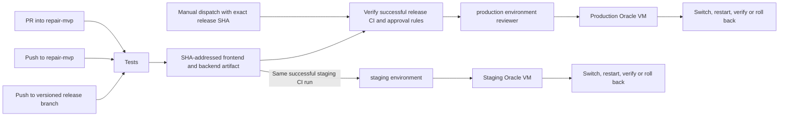

# RushX Oracle CI/CD

## Audit · 2026-11-13

The baseline was `8de6d0b`, which includes the staging database guard (#52) and restricted WhatsApp OTP (#53). `tests.yml` already used a disposable MongoDB service, backend pytest, Jest, React build, Playwright and Storybook. The production artifact workflow and the frontend-only Oracle workflow both build frontend artifacts. The latter already includes archive validation, a privileged symlink switch helper, smoke tests and rollback. Its repository deploy flag was false at inspection. The existing workflows and their scripts are preserved.

The 2026-11-10 production handoff describes a manual frontend tarball cutover and a historical backend Git checkout. It does not establish the currently active release layout. No Nginx or systemd units are tracked. The public staging and production frontend and `/api/` returned HTTPS 200 with valid TLS. The pinned staging IP rejected the available SSH identity. The staging deployment mechanism, actual accounts, service names, environment loading, paths, Python/ABI, Nginx routes and whether either host already uses release symlinks remain unverified. Draft PRs #47 and #48 are overlapping proposals, so coordinate their disposition before merging.

GitHub showed no `staging` environment and reported `repair-mvp` as unprotected. The `production` environment allowed `release_*` and exposed no required-reviewer rule. Production cutover and staging activation require the operator steps below.

## Workflows



CI runs on PRs into `repair-mvp` and pushes to `repair-mvp` and `release_*`. PR checks use the merge result. CI packages the same React output used by its checks, committed FastAPI runtime files, and Python 3.12 Linux x86-64 wheels. Only canonical push runs upload the deployable artifact. The workflow scans the introduced history and final diff with redacted Gitleaks. It has no deployment secrets and tests against a local-only MongoDB instance. Both builds use same-origin `/api` and disable demo auth. The build has no server-side configuration. Current runtime `REACT_APP_*` reads are demo and map-related. The React API and Google login routes are relative.

Staging CD is a same-revision reusable workflow called after the test and artifact job. This avoids a `workflow_run` trigger that would require registration on the default branch, currently `main`. Only canonical `repair-mvp` pushes can call it and the candidate must still be the protected branch head immediately before SSH. The host refuses CI run numbers at or below its last successful deployment. Rerun the whole CI workflow if the artifact is missing or expired.

Production dispatch uses a branch matching `release_YYYYMMDD_versionX.Y.Z` and requires its full SHA as input. It selects the latest completed matching push run of `tests.yml` in this repository and requires success. It downloads the artifact from that run and attempt. It verifies the reviewer policy and checks the approval record before transfer. The production workflows share one concurrency group. The unified gate also refuses to run while the legacy flag is enabled.

## GitHub setup

Configure these values only after review and the relevant rollout approval. Store SSH keys and host pins only in their named environments. Use separate key pairs and distinct VMs and verify the pins independently.

| Scope | Variables | Secrets |
|---|---|---|
| Repository | `RUSHX_STAGING_CD_ENABLED` and `RUSHX_UNIFIED_PRODUCTION_ENABLED` default off. Keep `RUSHX_AUTO_DEPLOY_ENABLED=false` for the unified production cutover. | None for unified CD |
| `staging` | `RUSHX_STAGING_ORACLE_HOST`, `RUSHX_STAGING_ORACLE_USER` | `RUSHX_STAGING_ORACLE_SSH_KEY`, `RUSHX_STAGING_ORACLE_KNOWN_HOSTS` |
| `production` | `RUSHX_PRODUCTION_ORACLE_HOST`, `RUSHX_PRODUCTION_ORACLE_USER` | `RUSHX_PRODUCTION_ORACLE_SSH_KEY`, `RUSHX_PRODUCTION_ORACLE_KNOWN_HOSTS` |

- Protect `repair-mvp` and `release_*` with reviewed changes, trusted creation, and no force-pushes or deletion. Require the `test` check for changes into `repair-mvp`. Ensure protection appears as `.protected == true` in the GitHub branch API. Protect workflow and deployment code with review ownership.
- Allow only the `repair-mvp` **branch** in `staging`, with no human reviewer gate for continuous deployment. Allow only `release_*` **branches** in `production`. Configure production required reviewers, prevent self-review and disable admin bypass.
- Limit access to the Actions deployment settings. The deploy token reads repository refs and, in production, the Actions approval history. It does not change protection rules.
- Check runner statuses and environment deployment history. A PR check does not establish that either environment is ready.

## Inventory each VM before provisioning

On the approved VM, identify its effective Nginx root and preserved `/api/` upstream, FastAPI unit, service account, working directory, executable, environment-file path, any workers, and current build/release SHA. Record the filesystem and free space. Keep detailed config in the operator's private inventory and omit secret values, inline service environment and customer logs from transcripts.

```sh
sudo nginx -t
sudo nginx -T 2>/dev/null | awk '$1 ~ /^(server_name|root|proxy_pass|location)$/'
systemctl list-units --type=service --state=running
systemctl show VERIFIED_SERVICE -p FragmentPath -p DropInPaths -p WorkingDirectory -p User -p Group -p EnvironmentFiles
ss -ltn
df -h
uname -m
python3.12 --version
```

For a Git checkout, use `git -C VERIFIED_PATH rev-parse HEAD` and `git -C VERIFIED_PATH status --short`. For a static root, compare the asset manifest and hashes with the known artifact. If they disagree, capture both active versions as a recovery pair. Confirm the API startup process performs index initialization. Changes to indexes or data require independent review, since release rollback does not undo database effects.

## Host prerequisites and first staging rollout

1. Rehearse off-VM, then provision staging during approved maintenance. Confirm Linux x86-64, compatible glibc and Python 3.12 venv support, sufficient disk for wheels and releases, and public HTTPS from the host. Keep FastAPI on its verified loopback port. Confirm the VM's Atlas identity is scoped to the dedicated staging database and its network access is limited to staging infrastructure. The production account and cluster must be inaccessible from staging.
2. Choose a local-filesystem release root. Use a dedicated unprivileged deployment account, a separate non-root runtime account, and root-owned, non-writable parent directories above the release root. Give the deployment account control of the release root and runtime accounts read/traverse access. Do not share the deployment account with the legacy frontend deployer. Install the reviewed `scripts/oracle_release.py` as root-owned executable `/usr/local/bin/rushx-oracle-release`. Use a dedicated authorized key with `restrict,command="/usr/local/bin/rushx-oracle-release"`; disable password and interactive access for the deployment account. Add only these two exact sudo commands for that account via `visudo`, using the verified unit names and systemctl path: `/usr/bin/systemctl start PREFLIGHT_UNIT.service` and `/usr/bin/systemctl restart FASTAPI_UNIT.service`. The deploy account must be unable to alter either unit, its dependencies, the preflight code or the runtime environment.
3. Install root-owned `/etc/rushx/oracle-release.json` on each host. The keys are `environment` (literal `staging` or `production`), `root` (verified absolute release root), `python` (verified absolute Python 3.12 path), `service` (existing FastAPI unit), `preflight_service` (dedicated oneshot), and `loopback` (verified `http://127.0.0.1:PORT`). The host rejects the other environment before any service command.
4. Preserve a bootable `releases/initial-stable/{frontend,backend,venv}` with the previous assets, API and a working interpreter. Create `current` pointing at that release and seed `deployed.json` with `{"sha":"initial-stable","sequence":0}`. Keep an independent backup of the current configuration and deployment. Establish and verify the legacy rollback pair before allowing unified deployment. Serve the existing frontend via `current/frontend` and configure the FastAPI unit to execute `current/venv/bin/python -m uvicorn server:app …`. Resolve the working directory through `current/backend` at every restart. Preserve the original verified listener, service hardening, TLS, other routes and `/api/` prefix. A single atomic pointer switch coordinates both components, with a short service restart window. Cache HTML, `/rushx-release.txt` and readiness with revalidation or disabled caching. Keep the legacy frontend layout available separately during migration.
5. Preserve runtime secrets in an operator-owned systemd `EnvironmentFile` outside the release tree. Load the same environment file and relevant settings in the API unit and in a root-owned oneshot preflight unit running as the API account. Use the same final `RUSHX_RELEASE_ENVIRONMENT=staging` (or `production`) in both units. The oneshot must run an **operator-owned** copy of `backend/release_environment.py` and its imports using a reviewed interpreter with the application dependencies. Do not use a `RemainAfterExit` oneshot, since each deploy must rerun the check. The new FastAPI process also validates its effective environment before constructing MongoDB. Review other services independently if they use the same code or environment.
6. In staging, retain the dedicated Atlas credentials, `APP_ENV=staging`, `CORS_ORIGINS=https://staging.evchargerrepair.in`, `OTP_MODE=provider` and existing notification, demo OTP, merchant QR and CMS restrictions. Use `OTP_DELIVERY_PROVIDER=none` until specifically approved for a staging OTP test. In production, configure `APP_ENV=production` and independently reviewed `RUSHX_EXPECTED_ATLAS_HOST`, `RUSHX_EXPECTED_ATLAS_USER` and `RUSHX_EXPECTED_DATABASE` matching the real approved destination. Both deploy preflights require MongoDB Atlas SRV with verified TLS. Verify compatibility before planning cutover. Keep application secrets such as `MONGO_URL`, `JWT_SECRET`, Google and Meta credentials on the server.
7. Verify legacy health through both local API and public HTTPS. Review GitHub staging config and enable `RUSHX_STAGING_CD_ENABLED` only after approval. A successful canonical baseline push then deploys, or rerun all jobs on the still-current post-merge push. Inspect the Actions summary, `deployed.json`, frontend marker and API readiness. Rehearse a failed smoke and recovery in the staging rehearsal environment before moving to production.

## Production migration, release and approval

Review the unified implementation and validate staging, including a complete rollback rehearsal. Separately approve the production maintenance window, compare the live Atlas/VM inventory to this runbook, provision the independent rollback pair and back up the existing Nginx and systemd configs. Keep the legacy deploy flag false and check there are no queued or active legacy deploys before changing the host layout. Enable the production reviewer gate and the unified flag only for the approved migration. Keep the old workflow until a separately reviewed retirement.

Register the production dispatch workflow on the GitHub default branch (`main`) through a separate reviewed PR before cutover. GitHub requires the workflow file on the default branch for manual dispatch. Keep the unified flag off during registration. Create the approved `release_YYYYMMDD_versionX.Y.Z` branch at the reviewed integration commit. Record its head SHA and wait for its **push** Tests run. Dispatch **Deploy unified RushX release to Oracle production** on the release branch with the exact SHA. A different approved reviewer checks the commit, CI result, staging evidence and recovery plan before approving the `production` job. The job rejects a superseded head. Branch creation alone runs CI and may build legacy artifacts. Leave the legacy flag false during the unified operating period.

## Rollback and troubleshooting

The host verifies SHA-256 during transfer, unpacks ordinary bounded files, checks both release markers, installs release-local dependencies from the wheel bundle and records a journal before switching. It verifies the public HTML and JS/CSS bytes, the public frontend SHA and both loopback and public backend readiness including MongoDB ping. The backend SHA is read relative to the running code. Identity provider uptime is outside deployment verification.

The host restores and verifies the previous release on activation failure. A killed process, VM outage, failed rollback or unexpected filesystem state can require operator recovery. Leave both versions and `pending.json` in place until recovery is complete. Disable unified promotion and drain active jobs. Under the same host `deploy.lock`, validate the rollback target and atomically replace `current` using a temporary symlink on the same filesystem. Restart the existing unit and verify both components. Reconcile `deployed.json` to the actual active SHA, keeping its sequence at least as high as the highest verified successful deployment, before clearing the journal. Inspect abandoned incoming directories or unactivated candidate releases under the lock before removing them. Keep a previous known-good release and its deployment record when pruning. For disaster recovery restore the previous unit and Nginx configuration with the independent backup, verify TLS and restore compatible application artifacts. Restore Atlas only under an independently authorized recovery plan.

- No staging job usually means an off switch, wrong repository/ref, or failed CI. Check artifact upload and branch protection before retrying.
- A rejected production job can indicate policy drift, a missing reviewer, expired artifact, wrong SHA, or legacy deploy enabled. Recheck settings before dispatching again.
- Transfer failure calls for host-pin, SSH account, forced-command and target-environment checks. Compare archive hashes. Do not bypass pinning.
- For a readiness failure check service startup, virtualenv/ABI, index initialization, Atlas reachability, Nginx routing and caching. Inspect logs privately. Check that the configured probes return the expected version and that no redirects, caching or proxy modifications alter their responses.
- On a stale candidate, deploy the current protected head with a later successful CI run. For deliberate rollback, use the operator recovery procedure. Repeated restart failures, disk loss and incompatible schema changes need operator intervention.

## Authorized staging authentication smoke

CI uses mock provider calls and controlled identities. No automatic deploy step starts an OTP challenge or Google login.

- **WhatsApp OTP.** After explicit authorization, verify a dedicated Meta staging sender and token, and independently set `RUSHX_EXPECTED_STAGING_WHATSAPP_SENDER` to its numeric ID. Verify Meta approval for the exact `WHATSAPP_OTP_TEMPLATE` and `WHATSAPP_OTP_LANGUAGE`, including its OTP body and URL button. Limit `STAGING_OTP_ALLOWED_PHONES` to consenting staging test accounts. Keep lifecycle notification flags false. First confirm denial for a controlled non-allowlisted test identity without a provider send. Then request and verify OTP on one allowlisted staging identity, verify the authenticated session and inspect staging-only delivery evidence. Revert to `none` and remove the allowlist when the approved smoke is complete. Treat provider approval and account permissions as operator-verified values.
- **Google Sign-In.** In the staging OAuth client allow `https://staging.evchargerrepair.in` and the exact `https://staging.evchargerrepair.in/api/auth/google/callback`. Configure `GOOGLE_CLIENT_ID`, `GOOGLE_CLIENT_SECRET` and `GOOGLE_REDIRECT_URI` on the backend. The frontend uses the relative login route. With a controlled Google test identity, verify the redirect and return over HTTPS, state rejection on mismatch, and successful `/api/auth/me`. Check `Secure`, `HttpOnly` and `SameSite=Lax` on the transaction and session cookies, the transaction cookie path, and logout. Keep codes, cookies, provider tokens and phone numbers out of evidence. A live Google or Meta outage is handled separately from deployment rollback.
