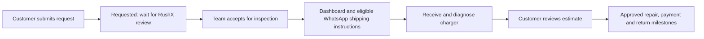

# WhatsApp lifecycle updates — detailed design

Status: OWNER-APPROVED DESIGN DIRECTION, updated 2026-11-20 for the approved eight-message amendment. The original requirements were finalized and merged in PR #72 at `repair-mvp` commit `20ff7ca96fa1513b3f2eb2d32b0936ec741c7772`; the owner-approved eight-message amendment is recorded in this PR and requirements.md. The owner approved the design and requested the eight-message amendment; the plan below records the updated contracts and defaults, not implemented behavior. Implementation tasks are prepared for separate review. No runtime implementation, activation or live sends are authorized by this documentation update.

## 1. Customer experience

Messages complement the account journey; opting out does not remove any repair step. Exceptions follow the existing declined/not-repairable/cancelled paths.

### New repair request

Keep the existing full repair form and saved-address flow. Add an optional, unchecked checkbox: **“Send me WhatsApp updates about this repair.”** Helper text: “Receive key repair, estimate, payment and return-shipment updates. You can stop these updates from your repair details. You can always check progress in your RushX account.” Display the current verified destination using the existing phone-display convention; do not add another number-entry field.

| State | Customer sees / can do |
|---|---|
| Ready and phone verified | Checkbox enabled, unchecked; selecting it records consent for this repair only |
| Phone absent or unverified | “Verify your mobile to receive WhatsApp updates”; eligible customers open the existing phone-verification dialog inline; repair submission without updates remains available |
| Verification cancelled or fails | Preserve charger details, photos, selected addresses and consent choice; do not mark the phone verified or send a message |
| Delivery service unavailable or eligibility loading/fails | Checkbox disabled and unchecked; “WhatsApp updates are currently unavailable. Track your repair in your account.” Repair submission still works |
| Account/phone changes while form is open | Refresh eligibility, clear the selected checkbox and require the customer to review the new destination; retain the other draft fields |

Reuse CustomerPhoneLink for customer-role linking, without browser-storage persistence of the repair draft or OTP. Existing owner-role repair submission remains supported; this spec does not open customer-only linking APIs to owners or restore parked account flows. Owners can opt in only when their own current phone is verified through an already supported sign-in path; otherwise explain account tracking without blocking repair submission.

A successful new request remains **REQUESTED**. The confirmation reads: “Your repair request has been received. RushX will review the details before confirming whether you should send the charger. Please wait for acceptance and shipping instructions.” Show its request number and View repair action. Remove the automatic AWAITING_SHIPMENT PATCH. Display actual returned notification preference state; do not equate a checked checkbox with delivery.

### Repair details

Replace the unconditional “Please send your charger” panel with state-based next steps:

| Repair stage | Next-step wording / action |
|---|---|
| REQUESTED | Await RushX review; do not ship yet |
| AWAITING_SHIPMENT with recorded acceptance | Team accepted the charger for inspection; show the approved inbound instructions/address from the acceptance snapshot, even if WhatsApp is unavailable |
| Legacy AWAITING_SHIPMENT without acceptance evidence | Preserve recorded status; ask the customer to confirm instructions with RushX, without inventing acceptance or backfilling a message |
| Inbound transit / received / diagnosing | Explain the recorded stage and that the estimate follows assessment; no generic send-now instruction |
| ESTIMATE_SENT | Review the published estimate; retain Approve/Decline actions |
| Approved / repairing / completed / payment pending | Use the actual recorded state, amount and supported next action; do not invent completion dates or fees |
| Ready for return / dispatched / delivered / terminal exceptions | Use actual return-shipment/support information; preserve declined/not-repairable/cancelled handling |

A small **WhatsApp updates** panel shows one of: Enabled for this repair, Not enabled, Stopped, Paused after mobile change, or Currently unavailable. Pending/accepted/delivered/read are delivery facts for operators, not replacements for repair status or promises that a customer read a message. Only show Stop updates while repair-specific consent remains granted; withdrawal is available even when the sender/worker is down. On success refresh the canonical preference; on error retain state and offer retry. No re-enable/retarget control for an existing repair in version 1.

After phone replacement, show: “WhatsApp updates for this repair are paused because your mobile changed. Continue following progress here.” Successful same-number OTP login does not pause existing consent. Authentication by WhatsApp never opts a repair in.

All screens use canonical tokens/components, both themes, keyboard focus/labels and existing toast/error patterns. Preserve the existing `frontend/src/components/Logo.jsx` in CustomerShell and the admin shell: the green rounded-square mark with the filled Zap symbol and the complete RushX wordmark from PRODUCT_NAME. Do not replace it with plain text, recolor only the X, or create a parallel logo. No public homepage redesign or promotional delivery promise is included.

## 2. RushX acceptance and authorization

Reuse REQUESTED -> AWAITING_SHIPMENT; no extra repair status is needed. Remove AWAITING_SHIPMENT from CUSTOMER_SETTABLE and enforce admin-only authorization on the server. Keep legitimate customer IN_TRANSIT_TO_VOLTX, estimate decisions and cancellation permissions within their existing state/fact guards.

In AdminDashboard, replace the generic Awaiting shipment transition label for REQUESTED with **“Accept for inspection and provide shipping instructions.”** The confirmation previews the request number and configured inbound facility address, stating: “This accepts the charger for inspection. Repair feasibility and price remain subject to assessment and customer approval.” No acceptance checkbox is checked implicitly.

Continue using PATCH `/api/repairs/{id}/status` with target AWAITING_SHIPMENT, adding an acceptance confirmation object containing an explicit true acknowledgement and the server-issued acceptance-preview digest. The admin detail response provides the digest of the currently configured address/instruction version; the server recomputes it. A changed digest returns 409 and requires a refreshed preview. The client cannot supply the authoritative address. Legacy callers without explicit confirmation are rejected for this transition.

Require a real configured facility address even if messaging is off: customers still need usable dashboard instructions. Do not require Meta or worker availability to accept a repair. Persist `intake_acceptance` (actor ID, UTC time, address/instruction snapshot, configuration version) in the same revision-conditional repair update as status, history and any eligible outbox event. Do not include guarantees of repair success. Return the customer-safe instructions to the submitter only; hide actor metadata and address details from unrelated charger-owner projections. Restrict the configured facility address to the accepted snapshot; later configuration changes never silently rewrite an accepted repair.

Concurrent acceptance retries use the recorded acceptance digest and transition history: the same already-accepted instruction snapshot can return the persisted result without a new event; a changed/repeated incompatible request returns 409. Never allow a later generic status PATCH to create a second acceptance. Old clients cannot bypass the boundary merely because WhatsApp is disabled.

## 3. API and privacy contracts

| Contract | Proposed behavior |
|---|---|
| GET `/api/customer/whatsapp-capability` | Authenticated, no-store eligibility for customer/owner submitters: `available`, safe `reason_code`, verified display destination, and an opaque short-lived eligibility binding. No tokens, sender IDs, template names or queue details |
| POST `/api/repairs` | Preserve existing idempotency and optional boolean whatsapp_opt_in. An opt-in adds the capability binding to the fingerprint so a stale phone cannot be silently selected on an ambiguous retry. First check for an existing matching creation key before revalidating mutable eligibility, returning the original repair on an exact retry |
| GET `/api/repairs/{id}` | Add a derived `whatsapp_updates` object to the submitter's response: consent state, effective state, safe reason, masked destination and can_stop. Continue stripping raw consent, outbox, private actor and payment details. Other charger owners receive no notification preference or recipient data |
| DELETE `/api/repairs/{id}/whatsapp-consent` | Reuse existing submitter/support authorization, Origin protection and CAS. Idempotent withdrawal works independent of delivery readiness. Increment consent revision; never redirect/re-enrol |
| Admin readiness/metrics | Extend the existing aggregate metrics/readiness view with safe reason codes, current readiness, worker heartbeat age, suppressed/quarantined counts and receipt lag. Keep it admin-only; no message payload/recipient exposure |

The capability binding is purpose-specific, signed with the existing server signing facility and includes initiating user/session, current phone generation and destination digest, a ten-minute expiry and consent-copy version. It is not a provider token and must not authorize account linking/login. Do not log it. Refresh shortly before submission if stale. A stale/invalid binding on opt-in returns a structured 409 eligibility error before creation; retain the full form and allow explicit re-selection or submission without updates. Do not automatically retry the same creation key with different consent/destination facts after an uncertain response.

Configuration/worker availability can change after capability discovery. With valid identity consent, a messaging outage does not fail a valid repair creation: record the requested consent and return its actual effective state. An existing active activation scope may queue work through a temporary worker outage; no active scope means no outgoing event and no automatic later reconstruction of REQUESTED. The normal UI prevents selection while unavailable; the server does not invent a success claim for stale clients.

## 4. Consent and verified phone binding

Extend repair consent additively: `version=2`, `revision`, `opted_in`, `at`, `source=repair_submission_v2`, `destination`, `phone_generation`, and `activation_id`. Withdrawal adds withdrawn_at and increments its revision. Only server code sets identity/source/time/generation/activation fields. Missing consent, legacy versions and absent activation IDs are not eligible for new sends. Preserve records for audit; no bulk customer opt-in or migration is run.

Add `users.phone_generation`, interpreting absence as zero. Increment it atomically with a successful identity-changing phone link/replacement in the existing conditional user write. Preserve the retained-session/auth_epoch implementation, OTP purpose/session binding, ownership indexes and session invalidation. A same-number verification/login records verification but does not increment phone_generation. Do not use phone_verified_at as the generation, because normal sign-in updates that timestamp; do not use auth_epoch, because unrelated session revocation is not a number change.

At creation and before each dispatch/replay require: same repair submitter, active account, current verified phone equals the consent/job destination, matching phone generation, matching consent version/revision and opted_in=true. Generation prevents old consent becoming valid again if the account changes away and back to the same digits. Failed identity proof does not change the generation. No second multi-repair write is needed for phone replacement: effective pause is derived and jobs are suppressed when encountered. Event writers also check eligibility to avoid adding useless outbox entries.

### Race semantics — explicit design limit

Keep the existing nontransactional outbox approach and do not hold account/repair locks across provider HTTP. After acquiring a fenced job lease and immediately before the HTTP call, reload authoritative repair consent/status/facts and account phone generation, then revalidate both job and repair-dispatch lease owner/expiry and persist the send-intent marker with a conditional fence. Recheck eligibility and both lease fences after marker persistence; if invalid, finalize as suppressed without HTTP. If a read/marker write fails, do not dispatch; an uncertain marked attempt is not automatically replayed.

**Dispatch has a bounded race:** a withdrawal/phone change/pause observed before the final checks blocks sending; a change after the final checks can overlap an already-authorized in-flight attempt. The database and Meta do not share an atomic transaction. Do not promise that a preference change can retract such an attempt. Every subsequent claim/retry rechecks identity/consent and is blocked; no new destination is substituted. Test both sides of this boundary, including a paused worker between intent and HTTP. This is an explicit review point; stricter cross-service serialization would require a separate coordination design and OTP-flow assessment.

## 5. Durable events, ordering and freshness

Reuse repair-local outbox writes and the materialized whatsapp_jobs collection. Increment SCHEMA_VERSION from 2 to 3; old snapshots never become eligible by rewriting their version. Keep existing event identities: repair_id:REQUESTED and stable transition/payment event IDs. Add `occurred_at`, `source_revision` (post-commit repair revision), `user_id`, consent revision/generation, activation_id, template-manifest digest and `expires_at` to new immutable snapshots. PaymentService uses the same authoritative repair revision guard; do not derive sequence from reconciliation time or callback arrival.

Default maximum time to begin a new send attempt is **24 hours after the event**, including any retries/cooldowns; this is a proposed local freshness default, not a provider guarantee or customer SLA. Expired jobs are suppressed, not automatically reconstructed. Provider-accepted messages can still arrive later; never claim this local deadline controls Meta's delivery queue. Dashboard/support remains available.

| Event | Additional freshness requirement before an unaccepted send |
|---|---|
| REQUESTED | Request still awaits review; suppress if it has progressed or closed |
| AWAITING_SHIPMENT | Still awaiting inbound shipment, same explicit intake acceptance and instruction digest; suppress after inbound transit/receipt/closure |
| RECEIVED_AT_VOLTX | Still received/diagnosing; suppress when an estimate or later stage supersedes it |
| ESTIMATE_SENT | Same published estimate, still awaiting the customer's decision |
| CUSTOMER_APPROVED | Same recorded approval, still approved/repairing; suppress after completion or closure |
| REPAIR_RESULT | Completion plus verified balance; same balance attestation and eligible REPAIR_COMPLETED/PAYMENT_PENDING stage. Positive balance uses payment variant; verified zero uses no-payment variant. Suppress after balance/receipt changes or return/closure progress |
| PAYMENT_RECEIVED | Same committed verified full receipt; acknowledge only once within freshness window, even if repair status later progresses |
| SHIPPED_TO_CUSTOMER | Same confirmed dispatch/courier/tracking, repair still dispatched; suppress once delivered/completed |

All eight customer messages are supported, but a fast/changed journey need not send obsolete intermediate notices. Exception branches use existing dashboard/support handling, not invented templates.

Enforce one active dispatch per repair using a lease/control document keyed by a namespaced `(activation_id, repair_id)` ID in whatsapp_control, distinct from existing sender-cooldown IDs. Claims use atomic CAS and fencing and an expiry longer than the 20-second HTTP timeout (120 seconds, matching existing job leases); release with its owner token. Select by source_revision/event ID, not arrival time. Before sending a later event, account for earlier embedded outbox and pending/processing/retry jobs: reconcile them and suppress those now obsolete. Do not let a materialized later event jump ahead merely because an earlier outbox item has not been materialized.

A transient retry may defer a still-relevant later event, bounded by expiry. An earlier ambiguous attempt is terminal for automatic dispatch; it must not block the whole repair forever, but warn operators that provider arrival order can differ. The system orders dispatch attempts, not guaranteed customer delivery. Never replay an accepted/read/delivered or ambiguous job to repair ordering.

Add `suppressed` and `quarantined` terminal job states with bounded safe reason codes, not pretend provider failure states. Examples: consent_withdrawn, phone_changed, account_inactive, event_superseded, event_expired, activation_mismatch, legacy_snapshot. Signed receipts may still record a real in-flight delivery after a local stop; receipt evidence must be preserved, not downgraded to “never sent.”

### Combined completion/balance event and template variants

Use a single new logical event `REPAIR_RESULT`, distinct from the two existing internal status names. Marking a repair REPAIR_COMPLETED commits the normal history but does not enqueue the legacy completion notice. The existing admin balance-attestation operation may still run in REPAIR_COMPLETED or PAYMENT_PENDING. When it first commits a valid verified balance for a completed repair, include the immutable REPAIR_RESULT event and a repair-local `completion_notice` reservation in that same revision-CAS write. No notification is generated by draft balance input, missing reconciliation, or an unverified customer payment upload. Existing payment guards and full-receipt event semantics remain.

Reserve the deterministic ID `repair_id:REPAIR_RESULT` once per repair and retain the reservation even after reconciliation, suppression or privacy cleanup. That ID is identical for both variants, repeated attestations and status retries; do not key it by balance-save request or status event. A successful first reservation records its balance-attestation identity, selected variant, occurred_at and immutable values. Concurrent writers or idempotent retries return/reuse the original result. Snapshot amount is taken from verified_balance_summary with non-negative money validation, not the positive-only amount_due helper used by PAYMENT_PENDING. Unknown balance never selects the zero variant.

Proposed exact variants (en_US / Utility; names/copy are not provider-approved and are not submitted by this spec):

| Logical milestone / variant | Proposed template | Ordered body parameters | Body proposal |
|---|---|---|---|
| REPAIR_RESULT / amount_due | `rushx_repair_completed_balance_v1` | customer_name, repair_number, amount_due | Hello {{1}}, repair work for {{2}} is complete. The outstanding balance is INR {{3}}. Please check your RushX dashboard or contact support for payment instructions. We will share return-shipment details once dispatch is confirmed. |
| REPAIR_RESULT / no_payment_due | `rushx_repair_completed_no_balance_v1` | customer_name, repair_number | Hello {{1}}, repair work for {{2}} is complete. No payment is currently due. We will share return-shipment details once dispatch is confirmed. |

Template variant is fixed at event creation, included in the activation manifest/digest and validated by the worker. Positive variant requires amount_due > 0; zero variant has no amount/payment-instruction parameter. An opt-in outage or missing approved variant must never fall back to either legacy standalone message. Do not add a fake zero payment receipt or send PAYMENT_RECEIVED for a zero-balance attestation.

At dispatch recheck completion, attestation identity and balance, variant, consent and normal freshness/scope gates. If a later receipt settles an unsent positive-balance notice, suppress it; do not rewrite it into the zero variant or create a second completion notice. PAYMENT_RECEIVED can still notify using its verified receipt. If completion was already accepted by Meta, a later balance change does not cause another completion message. Unsupported subsequent balance/reminder communication needs reviewed support handling, not automatic replay. These suppression rules may mean fewer than eight messages in a fast or changed journey.

The 24-hour send window starts when the combined event becomes eligible (completion plus committed verified balance), not when completion alone was recorded. Repeated balance saves never refresh that deadline. The current graph has no direct zero-due REPAIR_COMPLETED -> READY_TO_SHIP path: no new edge or payment workaround is introduced by this spec. Record that operational limitation in acceptance; a zero-due onward-return policy needs a separately approved lifecycle change.

## 6. Activation boundary and readiness

Use a non-secret UUID activation_id and a shared database control record in whatsapp_control, scoped to environment/database/sender. Its fields include mode, activation_id, active/paused state, template-manifest digest, address/instruction digest, activation UTC time and latest worker heartbeat/version. No secrets or recipient lists in public records/responses. Operator-reviewed protected configuration pins the expected activation ID for API and worker; disagreement disables dispatch. Creation consent and each job bind to that ID.

Readiness requires all active template mappings for eight customer messages (including both combined-update variants), intended sender/mode, required secrets, valid facility instructions, active matching scope, supported schema and a worker heartbeat no older than **60 seconds**. The worker reports heartbeat at least every **15 seconds**, including idle periods; long throttles must not prevent health reporting. New UI capability fails closed if any dependency is missing. Authorized operators can see aggregate failing reasons; customers see only a generic unavailable state.

A separate operator readiness command validates configuration and required index definitions read-only before starting dispatch. Starting a worker is not the mechanism for probing production indexes: review/install missing indexes separately with authorization. Startup refuses conflicting definitions or absent readiness prerequisites instead of silently changing live schema. No event/consent backfill occurs.

Fresh activation uses a new ID. Pre-activation/legacy jobs and embedded events are classified/quarantined, with counts recorded, never bulk-reset or rewritten to the new ID. Reconciliation can archive their unsent metadata but cannot send them. Both replay and normal processing require current scope and all eligibility/freshness checks.

A temporary worker failure can resume the same active ID, subject to freshness and consent checks. An intentional operator pause immediately prevents new attempts once observed; record its boundary. Resuming the same ID is an explicit reviewed operation, including a queue-age and recipient audit. A sender/template/meaningful instruction change or new deployment activation requiring isolation uses a new ID; existing consent stays paused under its old scope, with no automatic re-enrolment. Do not rotate on every harmless code restart.

## 7. Template verification and provider compatibility

Preserve the seven unchanged selected message contracts, including CUSTOMER_APPROVED and PAYMENT_RECEIVED. Replace the two standalone REPAIR_COMPLETED/PAYMENT_PENDING notifications with one REPAIR_RESULT milestone using two mutually exclusive template variants. Verify name, en_US locale, Utility category, full components/body, current approved status, WABA/sender binding and variable order for every active variant. Eight customer milestones require nine template variants because REPAIR_RESULT has positive- and zero-balance wording. The two legacy standalone templates are not selected by new jobs or required for new readiness; keep their history reachable. Record a redacted verification manifest and digest with verifier/date; no token, business phone recipient, raw customer payload or private identifier in Git. A local approved flag is evidence of a recorded check, not perpetual Meta approval. Rejection/pausing at send time fails closed and alerts operators; do not switch to arbitrary free text or another template.

Keep existing template references to the RushX dashboard. Do not add URL/button/header parameters unless an approved variant supports them and requirements/design are revised. No migration to another messaging product/API mode. Pin the already-selected supported Graph version explicitly after verifying compatibility; no automatic API-version upgrade or OTP credential rotation.

Primary verification references (consulted 2026-11-20; they do not verify this account): [Meta message-template inventory/status reference](https://developers.facebook.com/docs/graph-api/reference/whats-app-business-account/message_templates/) and [Meta template reference](https://developers.facebook.com/docs/graph-api/reference/whats-app-business-hsm/). Exact live account status and component contracts remain a pre-activation audit, not a design-time assumption.

## 8. Staging and operational separation

Add a narrow third lifecycle mode **staging**, retaining existing test and production semantics. Proposed protected settings: STAGING_LIFECYCLE_TEST_ENABLED (default false), STAGING_LIFECYCLE_ALLOWED_PHONES (explicit unique Indian E.164 recipients, maximum 10), STAGING_LIFECYCLE_PHONE_NUMBER_ID (expected sender binding), and the shared activation ID pin. Names are design proposals; no environment changes are made now.

For APP_ENV=staging, both API startup and worker entrypoint call shared isolation validation. Lifecycle sending requires mode=staging, the dedicated staging DB/user/host/origin already enforced, the extra gate, a nonempty valid lifecycle allowlist, exact sender binding, all active approved template variants, active staging control scope and WHATSAPP_PRODUCTION_APPROVED=false. Each event/enqueue/claim/retry rechecks recipient membership. The OTP allowlist grants no lifecycle permission. Outside this gate, existing no-send behavior remains.

Prefer a dedicated staging sender/account; if an already-onboarded production sender is proposed for an authorized owner-recipient test, its exact binding and shared-credential/OTP effects need explicit operator review before any test. Never silently set production mode/approval true on staging to bypass its guard. Staging jobs carry mode=staging and staging activation; production rejects them even if sender IDs happen to match. Malformed/empty allowlists and missing staging isolation fail startup and sending closed.

Real staging tests require explicit recipient/test-window authorization. MockTransport tests are the first stage; hello_world can establish transport only and cannot satisfy eight-milestone acceptance, including both combined-message variants. Webhook tests verify signature, sender scope, callback-before-ack, duplicate/late receipt handling and actual delivered evidence where available. Read receipts are not assumed available for every recipient; record absence honestly. No incoming-message auto-replies. Verify query-token redaction at the API, Nginx and monitoring layers before provider webhook verification; never capture verification-token URLs in shared screenshots/logs.

On Oracle, supervise `python -m services.whatsapp_worker` separately from rushx-backend with the same release SHA, private environment references and a non-root user. Stop dispatch before changing release/config; validate readiness; start the worker only in the approved window. Use SIGTERM-aware shutdown: stop new claims, allow a current bounded request to settle, retain ambiguous intent if interrupted; proposed TimeoutStopSec=40 seconds for a 20-second HTTP timeout. Do not print environment values or raw provider error bodies in service logs.

## 9. Metrics, recovery and retention

Reuse admin aggregate metrics and guarded single-job replay. Extend safe counters for suppressed/quarantined states, stale heartbeat, unsupported activation/schema and sequence blocking. Initial alert thresholds retain pending lag >300 seconds, any dead letter/expired lease, no receipt after >1 hour and repeated throttling; alert on heartbeat >60 seconds. A dead worker must be distinguishable from an empty queue. Pause sends for global configuration/scope drift; do not stop OTP/API or disable unrelated repairs.

Preserve five-claim bounded retry behavior, sender-wide cooldown, Retry-After handling, durable intent, 120-second fencing leases and no automatic ambiguous/failed-delivery replay. Replay must run the same current account/consent/scope/sequence/freshness validator as dispatch and reject old epochs, obsolete facts, any acceptance/delivery evidence and uncertain sends. An admin retry schedules only demonstrably unsent supported failures; no direct Meta call from an API handler.

Proposed privacy default: after 30 days from a terminal event, an explicitly reviewed maintenance process removes destination, personalization, rendered values and receipt details that are no longer needed. Retain minimal nonpersonal event/job identity, terminal outcome/ambiguity markers and deduplication tombstones while the repair source event can be replayed; do not delete whole jobs by TTL and permit duplicate reconstruction. Open/ambiguous investigations suspend payload purge under restricted access. Consent history stays with the repair under the business's approved record-retention policy; this spec does not invent a legal retention period or authorize a cleanup/migration. No automatic deletion job is enabled by this release without separate approval.

## 10. Compatibility, release and rollback

Data changes are additive/lazy: phone_generation defaults zero; new consent v2/intake acceptance/snapshot v3 apply only to new reviewed events. Existing repairs, estimates, verified receipts, status history and phone identities remain intact. New worker/control indexes and their permissions must be reviewed before installation; proposed indexes are jobs `(activation_id, repair_id, source_revision, state)` for ordering, plus existing pending/lease/receipt indexes. Control documents use Mongo _id uniqueness; no multi-document transaction is required. Bound/stream database audits rather than logging customer records.

Backend-first compatibility removes customer permission to accept intake; older frontends may attempt the automatic PATCH, which must be rejected without undoing creation. The new frontend removes that request and displays REQUESTED correctly. Coordinate both artifacts in one release so the old unconditional shipping copy is not left in use. No new customer flow enters a broad production branch merge.

After design and task approval: implement on repair-mvp feature branch, review/CI/merge, then authorized staging acceptance. For production, verify then-current frontend/backend revisions, agree the feature version (candidate next minor, not assigned automatically), create a fresh release branch from deployed baseline, create promotion branch, PR selected feature/dependency commits into that release, merge only with approval, run CI on resulting SHA and retain its exact artifact. Require separate deployment and message-activation approval, preserve historical refs and record component SHAs and worker version.

Activation checklist: verified active-template manifest, reviewed intake instructions, no unclassified backlog, recipient/consent eligibility audit, worker/index readiness, signed webhook receipt evidence, service stop/recovery rehearsal in isolated staging and observed delivery. Production start/first sends require approved recipients/window; no autonomous customer test sends.

Rollback first disables lifecycle enqueueing and pauses the shared scope, stops/drains the worker, and records any in-flight uncertainty. Preserve jobs/receipts and both existing/new data. Then restore the approved frontend/backend release pair and worker configuration. Older code does not enforce new consent/epoch checks, so lifecycle remains disabled and its old worker must not restart automatically. Preserve OTP sender/template/credentials and account tracking. Existing customer-profile linking-challenge expiry/session rollback caveats still apply; do not delete or invalidate live records without separate authorization. Re-enable only after a new reviewed readiness/queue plan, never by bulk replay.

## 11. Verification and review gates

| Area | Required design-validation scenarios |
|---|---|
| Acceptance | New requests remain REQUESTED; customer/owner cannot accept; admin explicit confirmation/address digest/CAS; concurrent duplicate acceptance; missing address; legacy records; dashboard instructions independent of Meta availability |
| Consent and auth | Default opt-out; Google-only verification retains draft; same-number OTP; phone change away/back; expired/wrong-purpose binding; stale sessions; withdrawal/provider outage; cross-customer/owner projections; no arbitrary recipients |
| Dispatch races | Withdrawal/phone/pause before and after final check; marker persistence failure; process suspension/crash; stale lease; no later retry to old or substituted number |
| Event pipeline | Eight milestone payloads and both combined-message variants; source revision/CAS; simultaneous receipt/status change; duplicate reconciliation; two workers; earlier embedded event vs later job; obsolete/expired events; old epoch/schema quarantine; safe-replay rejection |
| Provider/webhook | All active verified mappings; wrong locale/components/status; 429/5xx and Retry-After; ambiguous success/request timeout; webhook signature/body limits/scope; early/late/duplicate/read receipts and no state downgrade |
| Environment and ops | API and worker staging-gate negatives; isolated data; max allowlist; wrong sender/database/mode; stale heartbeat; disabled gates preserve OTP; supervision/graceful drain; cutoff and rollback rehearsal |
| UI and regression | Both themes and four widths; keyboard/focus/error/loading; preserved draft/defaults/creation retry; state-specific next steps; existing auth/profile/repair/payment/frontend/browser/Storybook coverage |

Use isolated disposable MongoDB for real CAS/lease/race/index tests and mocked provider HTTP for automation. Do not run test writes against production. Real provider acceptance remains the explicitly authorized staging step. Static document checks are not runtime tests; no runtime suite or live send was executed to author this proposal.

Design points recorded for implementation task review: acceptance UX/permissions, no re-enable on existing repairs in v1, 24-hour event freshness, proposed readiness timing and staging controls, and the explicit in-flight race limit. Use the dependency-ordered tasks in tasks.md, with explicit implementation authorization required after task review.

## 12. Source audit and template inventory

The following audit is retained as evidence of what existed before this design, not a claim that the proposal is implemented.

### Existing implementation to reuse

- `backend/services/whatsapp_service.py`: consent, nine-event catalog, immutable snapshots, environment/sender binding, configuration validation, durable reconciliation, leased/fenced dispatch, throttling, bounded retries, ambiguous-delivery review, signed receipts, aggregate metrics and guarded single-job replay.
- `backend/services/whatsapp_worker.py`: separately invoked worker entrypoint; not started by FastAPI. Source alone does not establish that any worker service is installed/running.
- `backend/server.py`: durable request/status events, verified-payment integration, business-fact validation, consent withdrawal, admin metrics and replay endpoints. Existing status transitions and payment constraints must be respected unless explicitly changed by approved requirements.
- `backend/templates/whatsapp_utility_catalog.json`: nine proposed templates; local approval fields are unknown. Eight lifecycle templates are required by the existing global production validation; PAYMENT_RECEIVED is validated when used. That was the original nine-message design input; the new active mapping and readiness contract are defined in sections 5 and 7.
- `backend/tests/test_whatsapp.py`, `test_whatsapp_lifecycle.py`, `test_whatsapp_mongo.py`, and payment tests: substantial mocked/integration coverage. `backend/WHATSAPP_VALIDATION.md` records historical runs, not results executed for this spec or provider approval.
- `frontend/src/pages/customer/RepairNew.jsx`: currently submits whatsapp_opt_in=false and displays disabled Coming soon copy. It then attempts an automatic REQUESTED -> AWAITING_SHIPMENT transition.
- `frontend/src/pages/customer/RepairDetail.jsx`: current repair status, estimate actions, history and consent withdrawal. The dashboard is the existing source of customer-visible progress.
- `backend/staging_safety.py`: currently rejects WHATSAPP_ENABLED=true or WHATSAPP_PRODUCTION_APPROVED=true in staging. The worker entrypoint does not currently call this shared validator; an authorized future test gate must cover the worker as well as API.
- `backend/whatsapp_otp_provider.py`: OTP shares sender/token/version settings with lifecycle code but uses its own authentication template. Preserve its working production and allowlisted staging flows.

### Source-grounded gaps and risks

1. Progress context described lifecycle wiring/tests as merely planned, but implementation and tests already exist. Work should complete/harden/integrate/verify that implementation rather than create a second outbox.
2. Activation is not just enabling a checkbox: shipping instructions could currently be enqueued immediately after submission. The owner approved team acceptance before shipping instructions on 2026-11-19; the actor/transition contract is now specified in section 2.
3. consent_record validates number syntax, not current phone verification; dispatch rechecks the repair's consent snapshot, not its current account number. Customer-profile phone replacement therefore requires explicit notification consent/race handling.
4. Existing retry logic can deliver older events after later ones. PAYMENT_PENDING rechecks its balance; equivalent freshness policy for other actionable events needs review.
5. Enabling a worker can reconcile existing embedded events/jobs. A reviewed activation boundary and old-job handling must prevent unintended historical sends.
6. No live Meta template, account, sender, webhook subscription, worker service, outbound gates or queue contents were inspected for this spec. Existing dated template evidence and successful OTP authentication do not establish lifecycle readiness.
7. Existing templates have no dashboard URL parameters. Do not append new variables/buttons or promise one-tap links without verifying an approved template variant.

### Existing nine-entry catalog at audit time (historical, not the new active mapping)

| Event | Local proposed name | Ordered body parameters |
|---|---|---|
| REQUESTED | `rushx_repair_requested_v1` | customer_name, repair_number, charger_description |
| AWAITING_SHIPMENT | `rushx_awaiting_shipment_v1` | customer_name, repair_number, dispatch_address |
| RECEIVED_AT_VOLTX | `rushx_charger_received_v1` | customer_name, repair_number |
| ESTIMATE_SENT | `rushx_estimate_ready_v1` | customer_name, repair_number, estimate_total |
| CUSTOMER_APPROVED | `rushx_estimate_approved_v1` | customer_name, repair_number |
| REPAIR_COMPLETED | `rushx_repair_completed_v1` | customer_name, repair_number |
| PAYMENT_PENDING | `rushx_payment_pending_v1` | customer_name, repair_number, amount_due |
| SHIPPED_TO_CUSTOMER | `rushx_return_shipped_v1` | customer_name, repair_number, courier, tracking_number |
| PAYMENT_RECEIVED | `rushx_payment_received_v1` | customer_name, repair_number, verified_amount, safe_reference |

All local entries use en_US and proposed Utility category. Exact live name, locale, category, full body, components/parameter order and current status must be verified with authorized access before sends; no template edit/submission is authorized.

## UI review record

- 2026-11-20: owner accepted the interactive UI direction with one correction: preserve the existing RushX logo. The preview was corrected to match Logo.jsx (mark, symbol and wordmark). Production implementation must reuse that component directly.
- 2026-11-20: owner subsequently approved the design, then confirmed eight WhatsApp messages by combining completion with verified balance while retaining estimate approval. The updated design and task plan reflect this; implementation-task authorization remains separate.

The audit table above intentionally preserves the existing catalog evidence. The new target is eight customer messages: seven unchanged contracts and the two mutually exclusive REPAIR_RESULT variants in section 5. Do not read the historical standalone rows as the proposed send plan.
